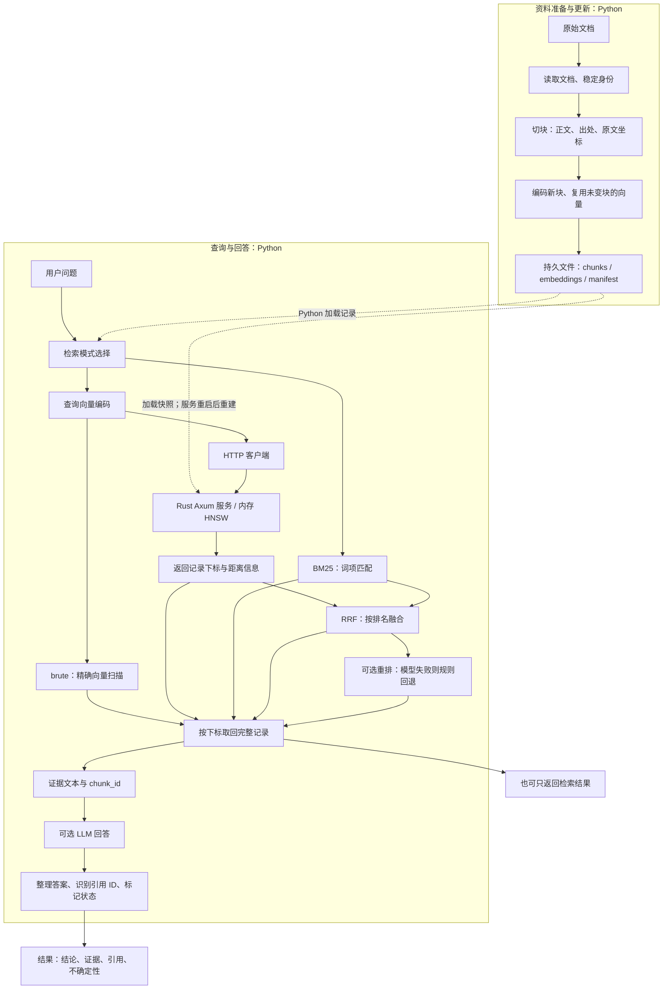

# Azusa：架构与面试复习

Azusa 是 Rust HNSW 向量检索与 Python RAG 实验项目，用于比较检索策略并追踪回答证据。
以下按当前主线整理，不把答案分支的 Filter/ACL 写成主线已完成能力。

## 架构图

箭头表示可选路径，并非每次查询都执行所有模块。hybrid 使用 HNSW 与 BM25；
hybrid_rerank 在扩大候选、RRF 融合后重排。brute/hnsw/bm25 可以独立运行。
评测层记录检索指标、逐题排名、耗时、实际后端、输入与源码身份；它不参与回答生成。
另有 Search Agent 查询规划与多步检索扩展，本轮重点是单次检索主链。

## 快速复读顺序

1. `rag/run_search.py:run_search_result`：看清检索和可选回答的总入口。
2. `rag/src/azusa_rag/search.py:search_records_with_sources`：看模式分派与结果还原。
3. `search_hybrid.py` → `search_sparse.py:rerank_candidates` → `reranker.py`：复习融合、重排、回退。
4. `search_hnsw.py` → `src/bin/azusa_server.rs` → `src/index/hnsw_impl/search.rs`：跟踪一次 HTTP 向量查询；需要时回看 `build.rs` 建图。
5. `answerer.py`：证据拼接、生成、输出规范化。知识库仅记住 `knowledge_base.py` 的构建与更新职责，暂不深挖。

第一次复述只回答：数据存在哪里、查询如何走、为何需要融合与重排、如何追踪证据。

## 三分钟讲述草稿

Azusa 是一个 Rust HNSW 检索底层加 Python RAG 流程的实验项目。它的目标是比较不同检索策略，
并追踪最终回答使用了哪些证据。

资料准备阶段，Python 读取文档、切块并计算向量，保存文本、出处、稳定 ID 和版本清单。
更新时尽量复用未变内容的向量。持久文件是数据来源，Rust HNSW 是可重建的内存索引；
当前知识库同步后需要重启重建索引，不是在线更新图。

查询阶段支持三种基础路径：BM25 做词项匹配，brute 精确比较向量，HNSW 通过 HTTP 调用 Rust
近似搜索。Hybrid 用 RRF 合并 BM25 与 HNSW 的排名，避免直接比较不同量纲的分数。
需要进一步精排时，扩大候选池，用查询和候选文本的成对模型评分重排。模型失败会降级到规则，
并记录实际后端和原因。

检索返回的下标会映射回完整记录，再把正文和 chunk_id 交给回答模型。输出规范化会识别
模型输出中已有的本次证据 ID，并标记缺少答案或引用等状态，不根据答案内容代补引用。
当前引用识别采用子串匹配，不能据此证明证据支持结论。

实验方面，底层有百万规模 SIFT 历史记录；上层文本检索此前主要是小样本回归。
2026-11-10 在 E5_server 完成十万段落、两千查询的 DuRetrieval BM25 实验，2026-11-11
取回并核对全部结果：Recall@10 为 0.5968，查询 P95 为 1286.61 ms。详见
[实验结果](text-scale-results-20261110.md)。这个实验复用 BM25 索引，查询延迟不能直接
对比每次重建索引的旧评测。2026-11-11 又完成同规模真实文本的精确向量检索与 Azusa
HNSW 对照：固定 BGE-small-zh-v1.5，ef=200 时证据 Recall@10 为 0.7886，精确检索为
0.7896；HNSW 原生查询 P95 为 12.01 ms（不含编码）。详见
[向量检索结果](text-dense-results-20261111.md)。随后完成三种插入顺序的稳定性实验，
ef=200 的证据 Recall@10 范围为 78.60%–78.82%，详见
[稳定性结果](text-hnsw-stability-results-20261111.md)。同规模 hybrid、rerank 对照仍待执行。

## 讲述边界

- 不是分布式向量数据库；当前 Rust 索引在内存中。
- Filter/ACL 主线尚有 TODO，完整参考实现在答案分支。
- SIFT 近邻召回、文本证据召回、生成答案质量是三层不同指标。
- 历史测试与实验结果不是当前工作区重新验证的结果；P0/P1 差异与当前状态仍需单独验收。
