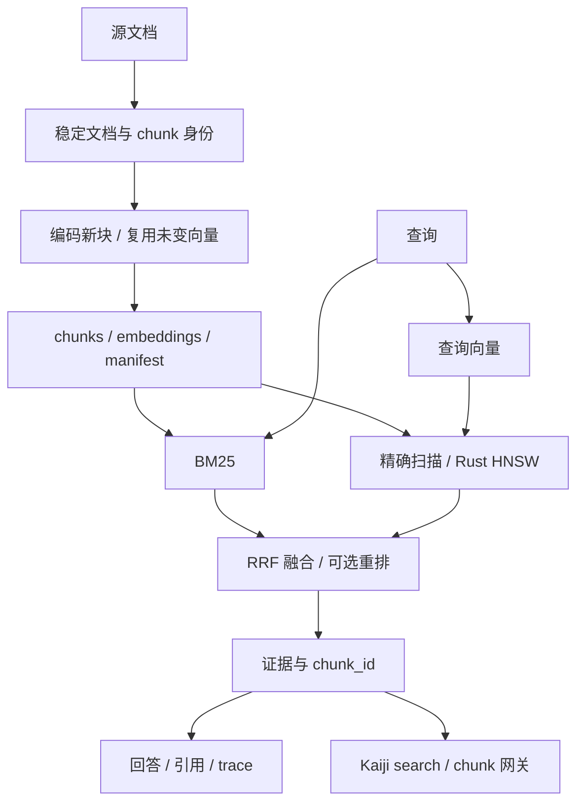

# 架构与设计

Azusa 将持久知识库、检索加速层和回答流程分开。Python 管理文档与证据，Rust 提供
内存 HNSW 索引；Kaiji 通过语义网关调用检索与正文读取。

图中箭头表示可选路径：brute、hnsw、bm25 可独立运行；hybrid 使用 HNSW 与 BM25，
hybrid_rerank 扩大候选后融合、重排。评测记录实际后端与耗时，不参与答案生成。

## 持久状态与索引

manifest、chunks、embeddings 保存当前知识库，HNSW 是可重建的内存加速层。
增量同步仅重算需要更新的向量，删除通过下一代产物不再包含旧证据实现；运行中的
HNSW 不支持在线删除，更新后须重启重建。三份文件分别原子替换，不构成多文件事务。

记录下标、Rust 索引 ID 与稳定 chunk_id 各有用途。Python 以有序记录快照绑定 Rust
索引，指纹覆盖文本、元数据、向量和顺序，避免等数量异语料或重排后取错正文。

## HTTP 边界

Rust/Python 通过 HTTP JSON 解耦，便于独立运行、检查请求和替换调用方。
当前不引入 PyO3 扩展构建，也不增加 gRPC 协议与生成代码。服务边界与输入校验见
[HTTP API](http_api.md)，不因此宣称分布式索引或生产级吞吐。

## 融合、重排与引用

dense 和 sparse 分数的量纲不同，hybrid 使用 RRF 按排名融合。重排使用更大的候选集；
模型不可用或分数非法时使用规则回退，并记录实际后端和原因。

答案上下文由真实命中记录构成。引用识别只接受本轮证据 ID，不用 top-1 代补；
ID 检查不能证明正文支持答案，仍需语义审查。查询规划、工具调用与重试见
[Search Agent](agent.md)，故障与评测边界见 [限制](limitations.md)。
